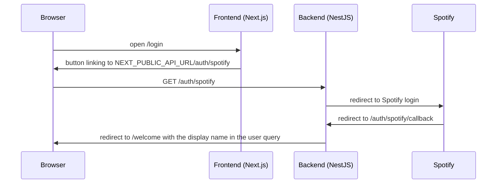

<div align="center">

# Mysic

**A Spotify login with a Next.js front and a NestJS back.**

[Run it locally](#running-it-locally) · [Futile Studio](https://futile.studio)

   [](https://github.com/MayurJivani/Mysic/commits/main)

</div>

> **Archive** · started Jul 2024 · login only so far

## Overview

Mysic is a small music app in two halves: a Next.js frontend and a NestJS backend. So far it does one thing. You log in with Spotify, and the welcome page greets you by your Spotify display name.

## How the login works



The backend asks Spotify for the `user-read-private` and `user-read-email` scopes. The code does not save the access or refresh tokens anywhere yet.

## Stack

- Frontend: Next.js 14.2.5 with the App Router, React 18, Tailwind CSS 3
- Backend: NestJS 10, Passport with `passport-spotify`, `@nestjs/config`
- Language: TypeScript on the backend, plain JavaScript on the frontend

## Running it locally

You need Node.js and npm. The repo does not pin a Node version.

First, make a Spotify app in the Spotify Developer Dashboard. Add this redirect URI to it:

```
http://127.0.0.1:5000/auth/spotify/callback
```

Then run the two halves. Each has its own `package.json`, so install them separately.

```bash
cd frontend && npm install && npm run dev
cd backend  && npm install && npm run start:dev
```

The frontend runs on http://localhost:3000. The backend listens on port 5000, set in `backend/src/main.ts`.

## Configuration

Backend, in `backend/.env`:

- `SPOTIFY_CLIENT_ID`: client ID from your Spotify app
- `SPOTIFY_CLIENT_SECRET`: client secret from your Spotify app
- `SPOTIFY_CALLBACK_URL`: the redirect URI you registered, for example `http://127.0.0.1:5000/auth/spotify/callback`

Frontend, in `frontend/.env`:

- `NEXT_PUBLIC_API_URL`: base URL of the backend, for example `http://localhost:5000`

There is no `.env.example` yet.

## Known issues

- The callback redirects to `/welcome` on the backend's own host. Unless a proxy sends `/welcome` to the frontend, the browser lands on the backend, which has no `/welcome` route.
- The login flow is not tested in full yet.
- The root page `/` is still the Next.js starter page.

## Project structure

```
backend/
  src/auth/      Spotify login route and Passport strategy
  src/config/    reads the SPOTIFY_* variables
  src/main.ts    starts the server on port 5000
frontend/
  app/login/     login button
  app/welcome/   greets the user by name
  app/page.js    still the starter page
```

## Licence

No licence file yet, all rights reserved.

---

<p align="center">
  <a href="https://futile.studio"></a>
  <br>
  <sub>Built by <a href="https://github.com/MayurJivani">Mayur Jivani</a>. Everything is futile. Do it anyway.</sub>
</p>
